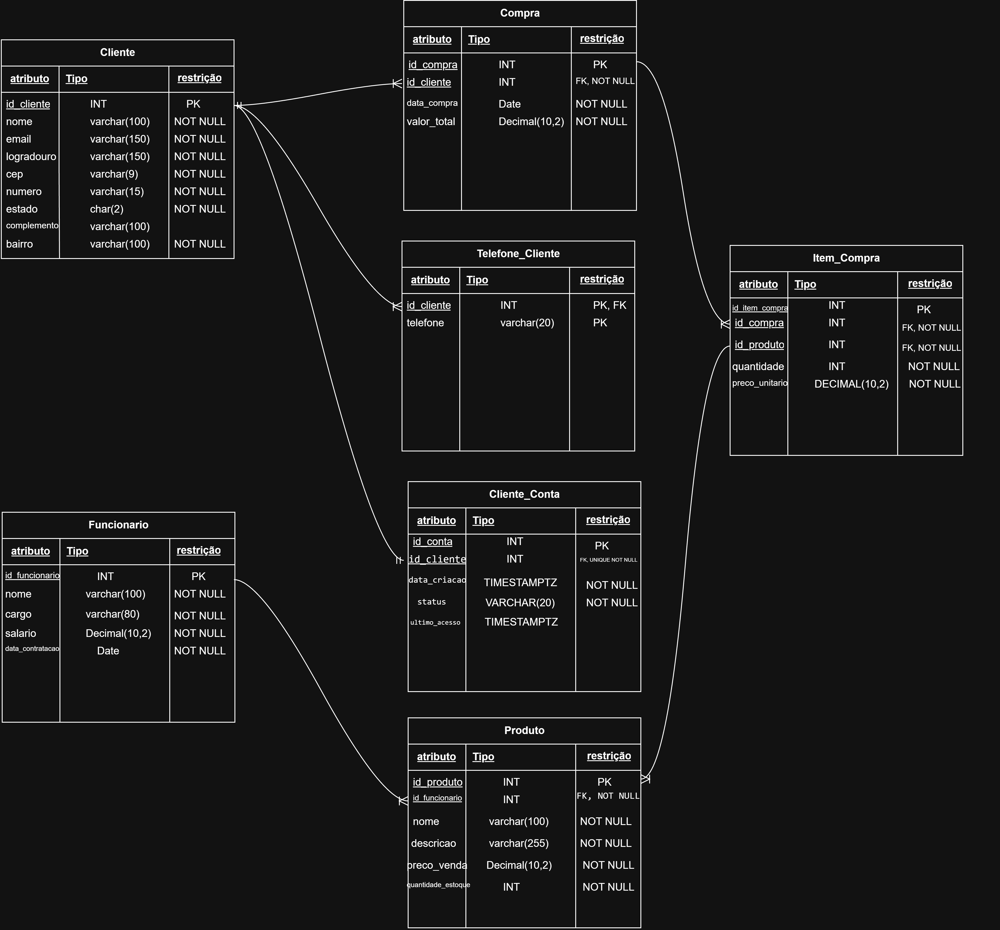
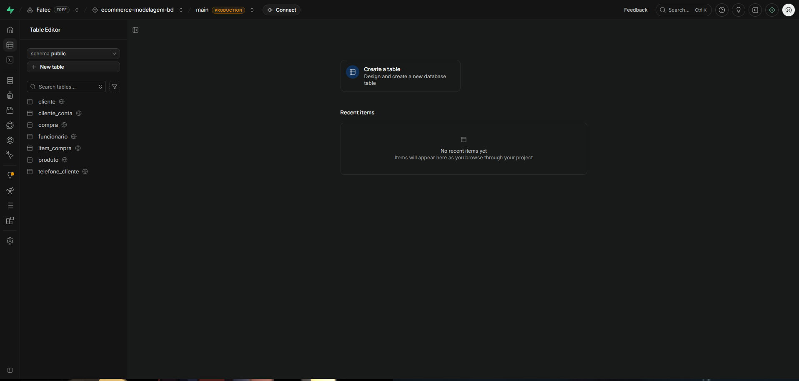
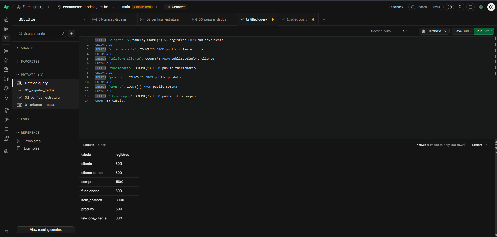
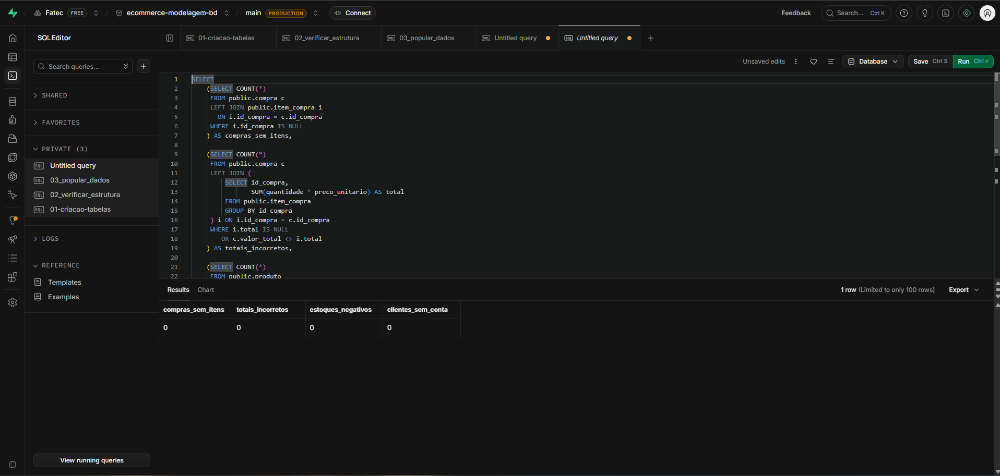
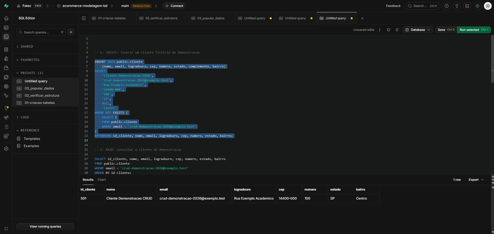
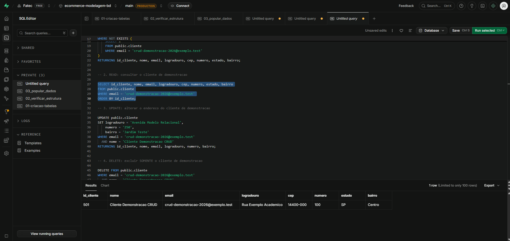
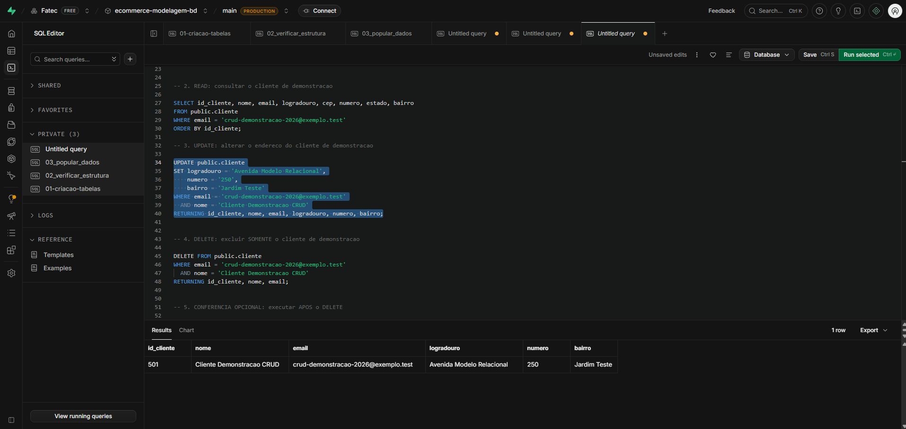
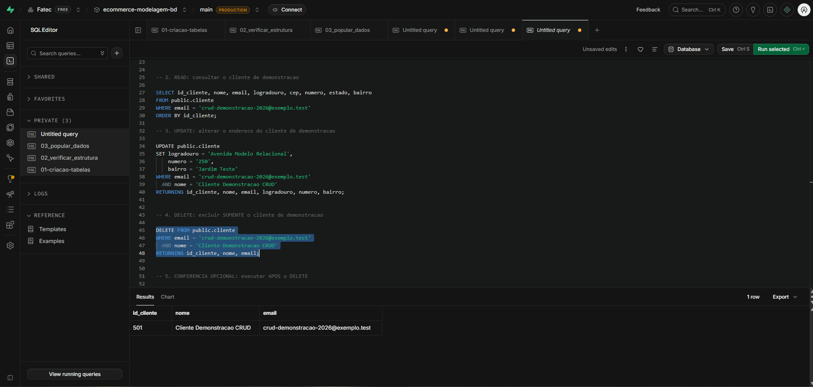

# Modelagem de Banco de Dados — E-commerce de Eletrônicos

**Projeto:** Sistema de gerenciamento de um e-commerce de produtos eletrônicos  

Este documento descreve o cenário de negócio e o desenvolvimento de um banco de dados relacional para um e-commerce de eletrônicos, abrangendo a modelagem conceitual, lógica e física, a inserção de dados fictícios e a demonstração de operações CRUD. O projeto contempla clientes, contas, funcionários, produtos e compras, com atenção à integridade referencial e à preservação do histórico das vendas.

## 1. Cenário

### 1.1. Descrição da empresa

O cenário apresenta uma empresa de grande porte que comercializa produtos eletrônicos pela internet, incluindo computadores, componentes, periféricos e acessórios. A loja atende clientes de diferentes localidades e conta com funcionários responsáveis pelo cadastro e gerenciamento dos produtos e pelo acompanhamento das informações de estoque.

Os clientes podem se cadastrar, manter suas informações de contato e realizar compras de um ou mais produtos. Para organizar essas operações, a empresa utiliza registros específicos para clientes, contas, funcionários, produtos, compras e itens adquiridos.

A quantidade de clientes, funcionários e transações exige uma estrutura relacional que evite a repetição desnecessária de informações e permita relacionar corretamente os dados registrados.

### 1.2. Problema e necessidade

O principal problema é organizar o grande volume de informações necessário ao funcionamento da loja. Sem um banco estruturado, seria difícil identificar quais compras pertencem a cada cliente, quais produtos foram adquiridos, suas quantidades, o preço cobrado em cada venda e o funcionário responsável por cadastrar determinado produto.

Além disso, o preço atual de um produto pode mudar. Por essa razão, o valor cobrado em uma compra precisa ser preservado separadamente do preço presente no catálogo, mantendo a consistência do histórico de vendas.

O banco de dados modelado organiza os cadastros, associa as informações por meio de chaves e permite representar tanto o estoque atual quanto os itens registrados em cada compra.

### 1.3. Entidades identificadas

Foram definidas **seis entidades** no Modelo Entidade-Relacionamento:

| Entidade | Função | Atributos |
|---|---|---|
| **Cliente** | Representa as pessoas cadastradas no e-commerce. | `id_cliente`, `nome`, `email`, `telefone`, `endereco` (composto por `logradouro`, `cep`, `numero`, `estado`, `complemento` e `bairro`). |
| **Cliente_Conta** | Registra informações da conta vinculada a um cliente. | `id_conta`, `data_criacao`, `status`, `ultimo_acesso`. |
| **Funcionario** | Identifica os funcionários da empresa e seus dados profissionais. | `id_funcionario`, `nome`, `cargo`, `salario`, `data_contratacao`, `tempo_de_empresa`. |
| **Produto** | Registra os produtos comercializados e os dados atuais de venda e estoque. | `id_produto`, `nome`, `descricao`, `preco_venda`, `quantidade_estoque`. |
| **Compra** | Registra cada compra efetuada por um cliente. | `id_compra`, `data_compra`, `valor_total`. |
| **Item_Compra** | Identifica os produtos associados a cada compra e seus dados no momento da venda. | `id_item_compra`, `quantidade`, `preco_unitario`. |

A entidade `Cliente_Conta` representa os dados administrativos da conta (criação, status e último acesso), enquanto `Cliente` concentra as informações cadastrais. O modelo não inclui credenciais ou gerenciamento de senhas.

### 1.4. Tipos de atributos

O modelo utiliza as categorias de atributos estudadas na disciplina:

- **Simples:** atributos que representam uma informação direta, como `nome`, `email`, `cargo`, `salario` e `preco_venda`.
- **Composto:** `endereco`, de `Cliente`, formado por seis subatributos: `logradouro`, `cep`, `numero`, `estado`, `complemento` e `bairro`.
- **Multivalorado:** `telefone`, pois cada cliente pode possuir mais de um número. No MER, é representado por uma elipse dupla.
- **Derivado:** `tempo_de_empresa`, calculado a partir da data atual e de `data_contratacao`. No MER, é representado por uma elipse tracejada.
- **Identificadores:** `id_cliente`, `id_conta`, `id_funcionario`, `id_produto`, `id_compra` e `id_item_compra`, representados por atributos sublinhados.

### 1.5. Regras de negócio

1. Cada cliente é identificado por um código único e pode registrar mais de um número de telefone.
2. Um cliente pode ter no máximo uma conta; cada conta pertence a um único cliente.
3. Um cliente pode realizar várias compras, mas cada compra pertence a um único cliente.
4. Uma compra contém um ou mais itens, e cada item corresponde a um produto específico.
5. Um mesmo produto pode aparecer em compras diferentes, e uma compra pode incluir produtos diferentes.
6. Cada item registra a quantidade adquirida e o preço unitário praticado na compra, independentemente do preço atual do catálogo.
7. O valor total da compra corresponde à soma dos valores de seus itens, considerando quantidade e preço unitário.
8. Cada produto está associado ao funcionário responsável por seu cadastro; o mesmo funcionário pode cadastrar vários produtos.
9. Os produtos possuem preço de venda e quantidade disponível em estoque, que representam suas informações atuais.
10. O tempo de empresa é obtido a partir da data de contratação do funcionário, sem necessidade de armazenar um valor que mudaria com o passar do tempo.

### 1.6. Relacionamentos e cardinalidades

| Entidades relacionadas | Nome do relacionamento | Cardinalidade | Significado |
|---|---|---|---|
| `Cliente` e `Cliente_Conta` | **Possui** | **1:1** | Cada conta corresponde a um cliente, e um cliente não pode ter mais de uma conta. |
| `Cliente` e `Compra` | **Realiza** | **1:N** | Um cliente pode realizar várias compras; cada compra pertence a um cliente. |
| `Compra` e `Item_Compra` | **Possui** | **1:N** | Uma compra possui vários itens; cada item pertence a uma compra. |
| `Produto` e `Item_Compra` | **Aparece em** | **1:N** | Um produto pode aparecer em vários itens; cada item referencia um produto. |
| `Funcionario` e `Produto` | **Cadastra** | **1:N** | Um funcionário pode cadastrar vários produtos; cada produto possui um funcionário responsável. |
| `Compra` e `Produto` | **Por meio de `Item_Compra`** | **N:N** | Uma compra pode conter vários produtos e o mesmo produto pode participar de várias compras. |

A relação entre `Compra` e `Produto` é representada por `Item_Compra`, uma entidade associativa que possibilita armazenar dados próprios de cada item vendido.

## 2. Modelagem Conceitual

### 2.1. Diagrama Entidade-Relacionamento (MER/DER)

[Visualizar o MER em tamanho original](Diagramas/MER.png)

O diagrama utiliza a notação estudada na disciplina: **retângulos** para entidades, **elipses** para atributos, **losangos** para relacionamentos e as indicações **1** e **N** para cardinalidades. Os atributos identificadores aparecem sublinhados, o atributo multivalorado é apresentado com elipse dupla e o derivado com elipse tracejada.

### 2.2. Descrição das entidades e dos relacionamentos

**Cliente:** representa os consumidores cadastrados. Possui identificador próprio, dados pessoais, endereço composto e telefone multivalorado. Relaciona-se com `Compra` por **Realiza (1:N)** e com `Cliente_Conta` por **Possui (1:1)**.

**Cliente_Conta:** reúne os dados da conta de um cliente, incluindo o identificador da conta, sua data de criação, status e último acesso. O relacionamento **Possui** associa a conta a um único cliente e limita o cliente a no máximo uma conta.

**Funcionario:** reúne as informações dos funcionários, como cargo, salário e data de contratação. O atributo `tempo_de_empresa` é derivado da data de contratação. O relacionamento **Cadastra (1:N)** indica que um funcionário pode ser responsável pelo cadastro de vários produtos.

**Produto:** representa cada item comercializado pela loja e guarda seu preço atual e quantidade em estoque. Um produto está associado a um funcionário responsável pelo cadastro e pode aparecer em vários registros de `Item_Compra`.

**Compra:** representa uma aquisição efetuada por um cliente, armazenando a data e o valor total. Uma compra pertence a um único cliente e está ligada a um ou vários registros de `Item_Compra`.

**Item_Compra:** representa cada produto incluído em uma compra e registra `quantidade` e `preco_unitario`. Essa entidade resolve a relação **N:N** entre `Compra` e `Produto`, por meio das relações 1:N **Possui** e **Aparece em**.

### 2.3. Justificativa da entidade Item_Compra

A entidade `Item_Compra` foi utilizada porque uma compra pode conter vários produtos e o mesmo produto pode ser adquirido em compras diferentes. Além de representar esse relacionamento, ela registra as características específicas de cada item no contexto de uma venda.

Por exemplo, se um produto estiver cadastrado com preço de venda de **R$ 200,00** e for comprado em uma promoção por **R$ 180,00**, o preço unitário do item da compra será **R$ 180,00**. Caso o preço do produto seja atualizado posteriormente, o valor associado àquela compra permanece registrado, preservando o histórico.

## 3. Modelagem Lógica

### 3.1. Diagrama do Modelo Lógico Relacional

[Visualizar o modelo lógico em tamanho original](Diagramas/Modelo_logico.png)

O modelo lógico é formado por **sete tabelas**: `Cliente`, `Telefone_Cliente`, `Cliente_Conta`, `Funcionario`, `Produto`, `Compra` e `Item_Compra`. A tabela `Telefone_Cliente` resulta da conversão do atributo multivalorado `telefone`, presente no MER.

Os identificadores das tabelas são definidos como **chaves primárias (PK)**. As **chaves estrangeiras (FK)** representam as ligações entre os registros e indicam quais tabelas estão relacionadas. Os tipos de dados refletem a natureza de cada atributo.

### 3.2. Estrutura das tabelas

#### 3.2.1. Cliente

| Atributo | Tipo | Restrição |
|---|---|---|
| `id_cliente` | `INT` | PK |
| `nome` | `VARCHAR(100)` | NOT NULL |
| `email` | `VARCHAR(150)` | NOT NULL |
| `logradouro` | `VARCHAR(150)` | NOT NULL |
| `cep` | `VARCHAR(9)` | NOT NULL |
| `numero` | `VARCHAR(15)` | NOT NULL |
| `estado` | `CHAR(2)` | NOT NULL |
| `complemento` | `VARCHAR(100)` | Opcional |
| `bairro` | `VARCHAR(100)` | NOT NULL |

O endereço composto foi desmembrado em colunas. Como o telefone é multivalorado, ele é armazenado separadamente em `Telefone_Cliente`.

#### 3.2.2. Telefone_Cliente

| Atributo | Tipo | Restrição |
|---|---|---|
| `id_cliente` | `INT` | PK, FK → `Cliente(id_cliente)` |
| `telefone` | `VARCHAR(20)` | PK |

A chave primária composta **(`id_cliente`, `telefone`)** permite cadastrar vários telefones para o mesmo cliente, sem repetir o mesmo número para ele. O campo `id_cliente` também é uma chave estrangeira.

#### 3.2.3. Cliente_Conta

| Atributo | Tipo | Restrição |
|---|---|---|
| `id_conta` | `INT` | PK |
| `id_cliente` | `INT` | FK → `Cliente(id_cliente)`, UNIQUE, NOT NULL |
| `data_criacao` | `TIMESTAMPTZ` | NOT NULL |
| `status` | `VARCHAR(20)` | NOT NULL |
| `ultimo_acesso` | `TIMESTAMPTZ` | Opcional |

A restrição `UNIQUE` sobre `id_cliente` impede que duas contas sejam vinculadas ao mesmo cliente. Com a chave estrangeira e `NOT NULL`, cada conta fica associada a exatamente um cliente existente. O relacionamento é **1:1**, considerando que um cliente pode ter no máximo uma conta.

#### 3.2.4. Funcionario

| Atributo | Tipo | Restrição |
|---|---|---|
| `id_funcionario` | `INT` | PK |
| `nome` | `VARCHAR(100)` | NOT NULL |
| `cargo` | `VARCHAR(80)` | NOT NULL |
| `salario` | `DECIMAL(10,2)` | NOT NULL |
| `data_contratacao` | `DATE` | NOT NULL |

O atributo derivado `tempo_de_empresa` não é armazenado em uma coluna, pois pode ser calculado pela diferença entre a data atual e `data_contratacao`.

#### 3.2.5. Produto

| Atributo | Tipo | Restrição |
|---|---|---|
| `id_produto` | `INT` | PK |
| `id_funcionario` | `INT` | FK → `Funcionario(id_funcionario)`, NOT NULL |
| `nome` | `VARCHAR(100)` | NOT NULL |
| `descricao` | `VARCHAR(255)` | NOT NULL |
| `preco_venda` | `DECIMAL(10,2)` | NOT NULL |
| `quantidade_estoque` | `INT` | NOT NULL |

A chave estrangeira `id_funcionario` identifica o funcionário responsável pelo cadastro de cada produto.

#### 3.2.6. Compra

| Atributo | Tipo | Restrição |
|---|---|---|
| `id_compra` | `INT` | PK |
| `id_cliente` | `INT` | FK → `Cliente(id_cliente)`, NOT NULL |
| `data_compra` | `DATE` | NOT NULL |
| `valor_total` | `DECIMAL(10,2)` | NOT NULL |

A chave estrangeira `id_cliente` relaciona cada compra ao cliente que a realizou.

#### 3.2.7. Item_Compra

| Atributo | Tipo | Restrição |
|---|---|---|
| `id_item_compra` | `INT` | PK |
| `id_compra` | `INT` | FK → `Compra(id_compra)`, NOT NULL |
| `id_produto` | `INT` | FK → `Produto(id_produto)`, NOT NULL |
| `quantidade` | `INT` | NOT NULL |
| `preco_unitario` | `DECIMAL(10,2)` | NOT NULL |

As chaves estrangeiras `id_compra` e `id_produto` conectam o item à compra e ao produto. Elas não são individualmente únicas, pois várias linhas podem compartilhar a mesma compra ou o mesmo produto. É essa combinação de relacionamentos que permite representar uma associação **N:N**.

### 3.3. Conversão do modelo conceitual para o lógico

A transformação do MER em modelo lógico seguiu as seguintes regras:

1. **Entidades em tabelas:** as seis entidades do MER foram representadas por tabelas relacionais.
2. **Atributos simples em colunas:** informações como `nome`, `email`, `salario` e `preco_venda` foram convertidas em campos das respectivas tabelas.
3. **Atributo composto em componentes:** `endereco` passou a ser representado pelos campos `logradouro`, `cep`, `numero`, `estado`, `complemento` e `bairro`.
4. **Atributo multivalorado em tabela:** `telefone` originou a tabela `Telefone_Cliente`, associada a `Cliente` por uma FK e identificada por uma PK composta.
5. **Atributo derivado não armazenado:** `tempo_de_empresa` permanece no MER como derivado e pode ser calculado a partir de `data_contratacao`.
6. **Relacionamento 1:1:** `Cliente_Conta` utiliza `id_cliente` como chave estrangeira com restrição `UNIQUE`, impedindo múltiplas contas para um mesmo cliente.
7. **Relacionamentos 1:N:** as FKs foram adicionadas às tabelas do lado N, como em `Compra.id_cliente` e `Produto.id_funcionario`.
8. **Relacionamento N:N:** a entidade associativa `Item_Compra` liga `Compra` e `Produto`, armazenando também a quantidade adquirida e o preço histórico do produto.

### 3.4. Funcionamento do modelo relacional

Os dados dos clientes ficam armazenados em `Cliente`, e os números de telefone ficam em `Telefone_Cliente`. As informações sobre a conta são registradas em `Cliente_Conta`, respeitando a associação 1:1 com o cliente.

Os produtos são cadastrados em `Produto`, com a referência ao funcionário responsável por seu registro. Quando um cliente realiza uma compra, a tabela `Compra` guarda a identificação do cliente, a data e o valor total. Cada produto adquirido é representado em `Item_Compra`, juntamente com sua quantidade e o preço unitário cobrado naquele momento.

Dessa forma, a estrutura relacional permite identificar clientes, funcionários e produtos, relacionar várias compras aos mesmos clientes, registrar diferentes produtos em uma compra e preservar os valores históricos das vendas, sem substituir os preços já registrados pelos preços atuais do catálogo.

### 3.5. Diagrama completo

[Visualizar o Diagrama completo em tamanho original](Diagramas/Diagrama_completo.png)

## 4. Modelagem Física

### 4.1. Implementação no Supabase

O modelo lógico foi implementado em um banco de dados **PostgreSQL**, utilizando o **SQL Editor do Supabase**. As sete tabelas foram criadas no esquema `public`, com tipos de dados, chaves primárias, chaves estrangeiras e restrições compatíveis com a modelagem definida anteriormente.

O script de criação está disponível em **[`sql/01_criacao_tabelas.sql`](sql/01_criacao_tabelas.sql)**. Ele organiza a criação das tabelas de acordo com suas dependências, evitando referências a entidades ainda não criadas.

A implementação utiliza:

- **Chaves primárias:** identificam unicamente os registros. Os identificadores principais são gerados com `GENERATED BY DEFAULT AS IDENTITY`.
- **Chaves estrangeiras:** relacionam clientes a contas, telefones e compras; funcionários a produtos; e itens de compra a compras e produtos.
- **`NOT NULL`:** impede a ausência de valores nos campos definidos como obrigatórios.
- **`UNIQUE`:** garante que cada cliente tenha no máximo uma entrada na tabela `cliente_conta`.
- **`CHECK`:** impede salários, preços, totais e estoques negativos, além de exigir quantidade positiva nos itens das compras.
- **`ON DELETE RESTRICT`:** impede excluir um registro referenciado por outra tabela, protegendo a integridade referencial.
- **Índices:** foram criados índices auxiliares nas principais chaves estrangeiras utilizadas em relacionamentos e consultas.

A tabela `telefone_cliente` possui a chave primária composta (`id_cliente`, `telefone`). Já `item_compra` possui uma chave primária própria e duas chaves estrangeiras, sem restrições `UNIQUE` individuais sobre `id_compra` ou `id_produto`, preservando a associação N:N entre compras e produtos.

A **Row Level Security (RLS)** está ativada em todas as tabelas. As demonstrações acadêmicas foram conduzidas diretamente pelo SQL Editor; não foram criadas políticas públicas de acesso aos dados por meio da API.

### 4.2. Verificação da estrutura

Após a criação, foram realizadas consultas de verificação para examinar as tabelas, suas colunas, os tipos de dados, as chaves primárias, as chaves estrangeiras, as restrições `UNIQUE` e `CHECK`, os identificadores automáticos e a configuração de RLS.

O arquivo **[`sql/02_verificar_estrutura.sql`](sql/02_verificar_estrutura.sql)** reúne essas consultas. As verificações confirmaram a existência das sete tabelas e dos relacionamentos definidos no modelo lógico.

### 4.3. Evidências da implementação

Os registros visuais foram obtidos no SQL Editor e no Table Editor do Supabase. Eles documentam a execução da criação, a listagem das tabelas e suas estruturas.

[Consultar as capturas de tela da modelagem física](Prints/Modelagem_Fisica/)

## 5. Dados

### 5.1. População do banco de dados

O banco foi preenchido com **7.400 registros fictícios**, distribuídos pelas sete tabelas, superando o mínimo exigido de 500 registros por tabela. Foram utilizados comandos SQL de inserção e geração de sequências de registros, com dados compatíveis com o cenário de comércio eletrônico.

| Tabela | Registros inseridos |
|---|---:|
| `cliente` | 500 |
| `cliente_conta` | 500 |
| `telefone_cliente` | 800 |
| `funcionario` | 500 |
| `produto` | 600 |
| `compra` | 1.500 |
| `item_compra` | 3.000 |
| **Total** | **7.400** |

O arquivo **[`sql/03_popular_dados.sql`](sql/03_popular_dados.sql)** apresenta a rotina de geração dos dados. Os nomes, contatos e produtos são fictícios e foram criados exclusivamente para fins acadêmicos.

Durante a população, os registros foram associados por meio de chaves estrangeiras. Cada cliente recebeu uma conta; alguns clientes possuem mais de um telefone; os produtos foram vinculados a funcionários; e cada compra recebeu dois itens referentes a produtos existentes. Os valores totais das compras foram calculados a partir das quantidades e dos preços históricos de seus itens. As quantidades vendidas também foram consideradas para atualizar o estoque cadastrado.

### 5.2. Verificação da quantidade de registros

Após o preenchimento, uma consulta de contagem confirmou a quantidade de linhas presentes em cada uma das sete tabelas.

### 5.3. Validação da consistência dos dados

Foram executadas consultas para verificar regras importantes do cenário. Os testes apresentaram os seguintes resultados:

| Verificação | Ocorrências encontradas |
|---|---:|
| Compras sem itens | 0 |
| Compras com valor total diferente da soma de seus itens | 0 |
| Produtos com estoque negativo | 0 |
| Clientes sem conta | 0 |

Esses resultados demonstram a consistência do conjunto de dados utilizado nas consultas realizadas, especialmente quanto aos totais das compras e às associações entre clientes e contas.

[Consultar as capturas de tela dos dados](Prints/Dados/)

## 6. CRUD

### 6.1. Demonstração das operações

Para demonstrar as quatro operações fundamentais de manipulação de dados — **Create, Read, Update e Delete** — foi utilizado um cliente fictício específico de teste. O uso de um registro isolado permite exemplificar as alterações sem modificar permanentemente os dados utilizados na população principal.

O script completo está disponível em **[`sql/04_crud.sql`](sql/04_crud.sql)**. Os comandos possuem condições para identificar o registro demonstrativo, reduzindo o risco de alterações em outros clientes.

### 6.2. Create — INSERT

A operação `INSERT` adiciona um cliente fictício à tabela `cliente`, informando nome, e-mail e endereço. O identificador é gerado automaticamente pelo PostgreSQL, e a cláusula `RETURNING` permite visualizar o registro criado.

### 6.3. Read — SELECT

A operação `SELECT` consulta os dados do cliente de demonstração utilizando a cláusula `WHERE` para filtrar o e-mail de teste e `ORDER BY` para ordenar o resultado pelo identificador.

### 6.4. Update — UPDATE

A operação `UPDATE` modifica os campos `logradouro`, `numero` e `bairro` do cliente de demonstração. O comando possui uma condição `WHERE` para limitar a atualização ao registro selecionado e utiliza `RETURNING` para apresentar os novos valores.

### 6.5. Delete — DELETE

A operação `DELETE` remove somente o cliente de demonstração, identificando-o por nome e e-mail. Dessa forma, os clientes originais e seus relacionamentos permanecem preservados.

### 6.6. Considerações sobre a demonstração

As operações CRUD exemplificam as instruções SQL utilizadas para inserir, consultar, atualizar e excluir registros. A demonstração foi realizada sobre a entidade `Cliente`, uma das entidades centrais do sistema, e ilustra o uso de filtros e restrições para evitar alterações indevidas.

[Consultar todas as capturas de tela do CRUD](Crud/)
